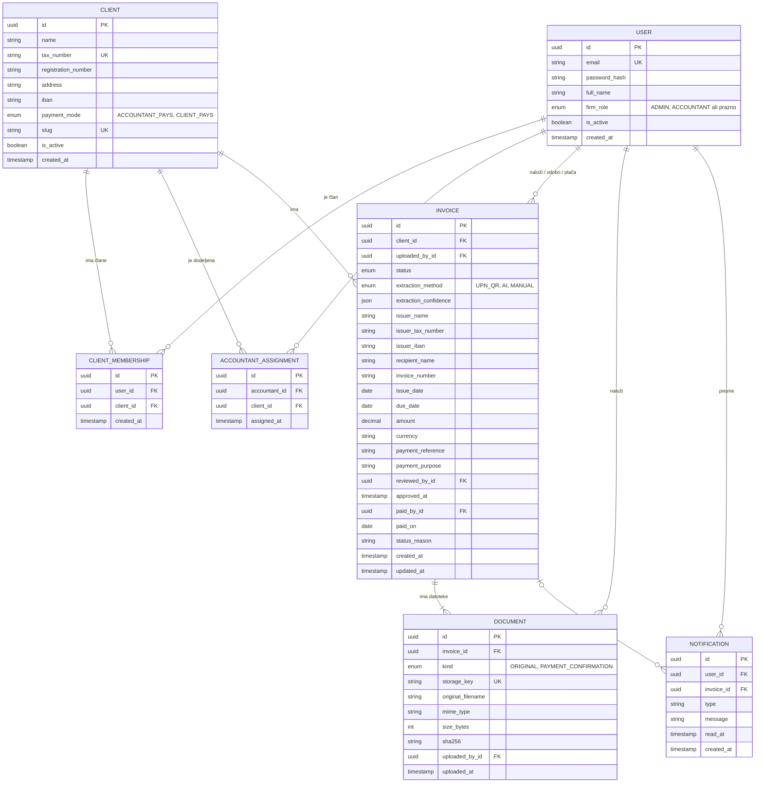

# Podatkovni model

## Izbrana podatkovna baza

Rešitev uporablja relacijsko podatkovno bazo **PostgreSQL**. Podatki so izrazito povezani (uporabniki, stranke, računi, datoteke, zapisi sprememb). Pri finančnih podatkih je pomembno tudi natančno shranjevanje zneskov s tipom `NUMERIC`, ne s plavajočo vejico.

Izvirne datoteke računov (PDF, slike) **niso shranjene v podatkovni bazi**, ampak v objektni shrambi (MinIO). V bazi je shranjen samo ključ (pot) do datoteke in njeni metapodatki.

## Entitete in glavna polja

### `user` – Uporabnik

Vsaka oseba, ki se prijavi v sistem: zaposleni v računovodskem servisu in uporabniki pri strankah.

| Polje | Tip | Opis |
|---|---|---|
| `id` | UUID, PK | Enolični identifikator |
| `email` | VARCHAR, UNIQUE | E-pošta za prijavo |
| `password_hash` | VARCHAR | Zgoščeno geslo (bcrypt/argon2) |
| `full_name` | VARCHAR | Ime in priimek |
| `firm_role` | ENUM (`ADMIN`, `ACCOUNTANT`), NULL | Vloga v računovodskem servisu; pri uporabnikih strank je prazna |
| `is_active` | BOOLEAN | Deaktiviran uporabnik se ne more prijaviti |
| `created_at` | TIMESTAMPTZ | Čas ustvarjanja |

Administrator ima vse pravice računovodje za vse stranke, zato lahko v manjšem servisu ena oseba opravlja obe vlogi.

### `client` – Stranka

Podjetje ali samostojni podjetnik, za katerega računovodski servis obdeluje račune.

| Polje | Tip | Opis |
|---|---|---|
| `id` | UUID, PK | Enolični identifikator |
| `name` | VARCHAR | Naziv (npr. Ratko d.o.o.) |
| `tax_number` | VARCHAR, UNIQUE | Davčna številka |
| `registration_number` | VARCHAR, NULL | Matična številka |
| `address` | VARCHAR | Naslov |
| `iban` | VARCHAR | Poslovni račun stranke, s katerega se plačuje |
| `payment_mode` | ENUM (`ACCOUNTANT_PAYS`, `CLIENT_PAYS`) | Kdo plačuje račune stranke |
| `slug` | VARCHAR, UNIQUE | Kratko ime za strukturo map v shrambi (npr. `ratko-doo`) |
| `is_active` | BOOLEAN | Neaktivna stranka ne more nalagati računov |
| `created_at` | TIMESTAMPTZ | Čas ustvarjanja |

### `client_membership` – Članstvo uporabnika pri stranki
 
Povezuje uporabnika s podjetjem stranke, en uporabnik je lahko povezan z več podjetja.
 
| Polje | Tip | Opis |
|---|---|---|
| `id` | UUID, PK | Enolični identifikator |
| `user_id` | UUID, FK → `user` | Uporabnik |
| `client_id` | UUID, FK → `client` | Stranka |
| `created_at` | TIMESTAMPTZ | Čas dodelitve |
 
Omejitev: `UNIQUE (user_id, client_id)`.

### `accountant_assignment` – Dodelitev stranke računovodji

Določa, katere stranke obdeluje posamezen računovodja.

| Polje | Tip | Opis |
|---|---|---|
| `id` | UUID, PK | Enolični identifikator |
| `accountant_id` | UUID, FK → `user` | Računovodja |
| `client_id` | UUID, FK → `client` | Stranka |
| `assigned_at` | TIMESTAMPTZ | Čas dodelitve |

Omejitev: `UNIQUE (accountant_id, client_id)`.

### `invoice` – Prejeti račun

Osrednja entiteta. Vsebuje podatke, prebrane iz dokumenta, in trenutni status v delovnem procesu.

| Polje | Tip | Opis |
|---|---|---|
| `id` | UUID, PK | Enolični identifikator |
| `client_id` | UUID, FK → `client` | Stranka, ki ji račun pripada |
| `uploaded_by_id` | UUID, FK → `user` | Kdo je račun naložil |
| `status` | ENUM | `UPLOADED`, `PROCESSING`, `IN_REVIEW`, `RETURNED`, `REJECTED`, `READY_FOR_PAYMENT`, `PAID`, `ARCHIVED` |
| `extraction_method` | ENUM, NULL | `UPN_QR`, `AI`, `MANUAL` – vir prebranih podatkov |
| `extraction_confidence` | JSONB, NULL | Zanesljivost branja po posameznih poljih |
| `issuer_name` | VARCHAR, NULL | Izdajatelj računa (dobavitelj) |
| `issuer_tax_number` | VARCHAR, NULL | Davčna številka izdajatelja |
| `issuer_iban` | VARCHAR, NULL | IBAN, na katerega se plača |
| `recipient_name` | VARCHAR, NULL | Prejemnik računa (za preverjanje, da je račun res za stranko) |
| `invoice_number` | VARCHAR, NULL | Številka računa |
| `issue_date` | DATE, NULL | Datum izdaje |
| `due_date` | DATE, NULL | Rok plačila |
| `amount` | NUMERIC(12,2), NULL | Znesek za plačilo |
| `currency` | CHAR(3) | Valuta, privzeto `EUR` |
| `payment_reference` | VARCHAR, NULL | Sklic (npr. `SI12 …` ali `RF …`) |
| `payment_purpose` | VARCHAR, NULL | Namen plačila |
| `reviewed_by_id` | UUID, FK → `user`, NULL | Računovodja, ki je potrdil podatke |
| `paid_by_id` | UUID, FK → `user`, NULL | Kdo je račun označil kot plačan |
| `paid_on` | DATE, NULL | Datum plačila |
| `status_reason` | TEXT, NULL | Razlog pri vrnitvi ali zavrnitvi |
| `created_at` | TIMESTAMPTZ | Čas nalaganja |
| `updated_at` | TIMESTAMPTZ | Čas zadnje spremembe |

Podatkovna polja so lahko prazna, dokler branje ni zaključeno. Pred prehodom v status `AWAITING_APPROVAL` aplikacija preveri, da so izpolnjena vsa polja, potrebna za plačilo (`issuer_name`, `issuer_iban`, `amount`, `due_date`).

Za zaznavanje podvojenih računov je ustvarjen indeks na `(client_id, issuer_tax_number, invoice_number)`. To ni omejitev enoličnosti, ker sistem ob podvojitvi samo opozori, odločitev pa ostane računovodji.

### `document` – Datoteka

Datoteka v objektni shrambi, povezana z računom. En račun ima lahko več datotek: izvirnik, popravljen izvirnik po vrnitvi in potrdilo o plačilu.

| Polje | Tip | Opis |
|---|---|---|
| `id` | UUID, PK | Enolični identifikator |
| `invoice_id` | UUID, FK → `invoice` | Račun, ki mu datoteka pripada |
| `kind` | ENUM (`ORIGINAL`, `PAYMENT_CONFIRMATION`) | Vrsta datoteke |
| `storage_key` | VARCHAR, UNIQUE | Pot v shrambi, npr. `clients/ratko-doo/2026/10/<id>.pdf` |
| `original_filename` | VARCHAR | Ime datoteke ob nalaganju |
| `mime_type` | VARCHAR | Npr. `application/pdf`, `image/jpeg` |
| `size_bytes` | INTEGER | Velikost datoteke |
| `sha256` | CHAR(64) | Zgoščena vrednost za zaznavanje enakih datotek in preverjanje nespremenjenosti |
| `uploaded_by_id` | UUID, FK → `user` | Kdo je datoteko naložil |
| `uploaded_at` | TIMESTAMPTZ | Čas nalaganja |

Kot trenutni izvirnik računa velja zadnja naložena datoteka vrste `ORIGINAL`.

### `notification` – Obvestilo

Obvestilo uporabniku, da ga čaka dejanje.

| Polje | Tip | Opis |
|---|---|---|
| `id` | UUID, PK | Enolični identifikator |
| `user_id` | UUID, FK → `user` | Prejemnik obvestila |
| `invoice_id` | UUID, FK → `invoice`, NULL | Povezan račun |
| `type` | VARCHAR | Npr. , `INVOICE_RETURNED` |
| `message` | TEXT | Besedilo obvestila |
| `read_at` | TIMESTAMPTZ, NULL | Čas branja; prazno pomeni neprebrano |
| `created_at` | TIMESTAMPTZ | Čas ustvarjanja |

## Povezave med entitetami

| Povezava | Tip | Opis |
|---|---|---|
| `user` – `client` prek `client_membership` | N:M | Uporabnik je lahko član več strank (npr. lastnik dveh podjetij) |
| `user` (računovodja) – `client` prek `accountant_assignment` | N:M | Računovodja obdeluje več strank, stranko lahko obdeluje več računovodij (npr. nadomeščanje). |
| `client` – `invoice` | 1:N | Vsak račun pripada točno eni stranki. |
| `invoice` – `document` | 1:N | Račun ima eno ali več datotek. |
| `user` – `invoice` | 1:N (večkrat) | Uporabnik naloži, pregleda,  ali označi kot plačane več računov (`uploaded_by_id`, `reviewed_by_id`, `paid_by_id`). |
| `user` – `document` | 1:N | Uporabnik naloži več datotek. |
| `user` – `notification` | 1:N | Uporabnik prejme več obvestil. |
| `invoice` – `notification` | 1:N | Račun lahko sproži več obvestil. |

## Osnutek podatkovnega modela (ER diagram)

