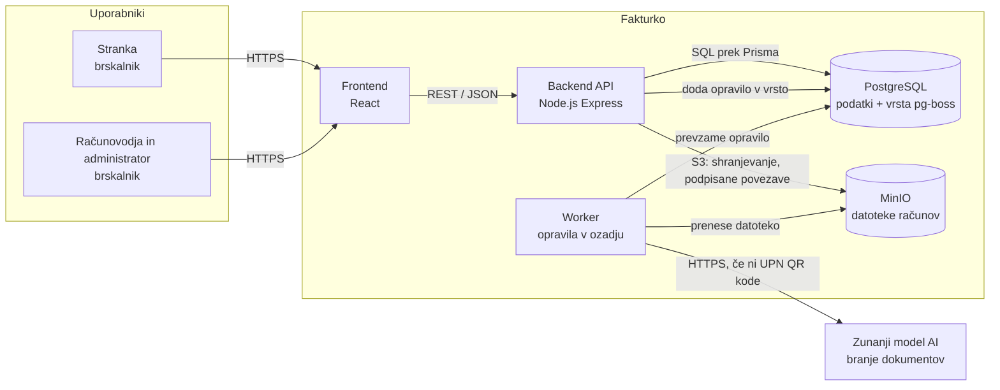

# Arhitektura in tehnološki sklad

## Arhitektura

### Glavni deli sistema

| Del | Naloga |
|---|---|
| **Frontend** | Uporabniški vmesnik v brskalniku za stranke, računovodje in administratorje. Prikazuje račune, omogoča nalaganje, pregled ob izvirniku, označevanje plačil in arhiv.|
| **Backend API** | Izpostavlja REST API, preverja avtentikacijo in pravice, izvaja poslovna pravila (veljavni prehodi statusov, ločenost podatkov strank) ter zapisuje podatke v bazo in datoteke v shrambo. |
| **Worker** | Ločen proces iz iste kode, ki izvaja opravila v ozadju: branje podatkov iz računov (UPN QR koda, AI), zaznavanje podvojenih računov in pošiljanje obvestil. |
| **PostgreSQL** | Hrani vse podatke o uporabnikih, strankah, računih, datotekah in obvestilih ter vrsto opravil v ozadju. |
| **Objektna shramba (MinIO)** | Hrani izvirne datoteke računov (PDF, slike) in potrdila o plačilu.|
| **Zunanja storitev AI** | Model za branje dokumentov, ki iz PDF-ja ali slike vrne strukturirane podatke računa v obliki JSON. Uporabi se samo, če račun nima UPN QR kode. |


Moduli zaledja: `auth` (prijava, žetoni), `users` (uporabniki), `clients` (stranke, članstva, dodelitve računovodjem), `invoices` (računi in delovni proces), `documents` (datoteke in shramba), `extraction` (branje podatkov), `notifications` (obvestila).

### Komunikacija med deli sistema

- **Frontend ↔ Backend API:** HTTPS, REST, podatki v obliki JSON. Nalaganje datotek poteka kot `multipart/form-data`.
- **Backend API → MinIO:** API naloženo datoteko preveri (vrsta, velikost), in jo shrani prek S3 protokola.
- **Backend API → Worker:** po nalaganju API ustvari račun s statusom `UPLOADED` in v vrsto  doda opravilo za branje podatkov. Vrsta je shranjena v PostgreSQL.
- **Worker → MinIO, AI, PostgreSQL:** worker prevzame opravilo, prenese datoteko iz shrambe, poskusi prebrati UPN QR kodo in, če je ni, pošlje dokument zunanjemu modelu AI. Rezultat zapiše v bazo in račun premakne v status `IN_REVIEW`. Ob napaki se opravilo samodejno ponovi.
- **Osveževanje statusa v vmesniku:** frontend med obdelavo računa periodično (vsakih nekaj sekund) preverja njegov status. 

### Diagram arhitekture




### Podatkovna baza

- **PostgreSQL** kot edina podatkovna baza za domenske podatke in vrsto opravil v ozadju.
- Zneski so shranjeni kot `NUMERIC(12,2)`, prebrani podatki z zanesljivostjo pa kot `JSONB`.


### Avtentikacija in upravljanje uporabnikov

- **Ni javne registracije.** Uporabniške račune ustvarja administrator.
- **Prijava z e-pošto in geslom.**.
- **Vloge in pravice:** vloge so `Stranka`, `Računovodja` in `Administrator`. Vloga v servisu je shranjena v `user.firm_role`, 

### Lokalni zagon

Celoten sistem se lokalno zažene z **Docker Compose**. Potrebna sta le Git in Docker.

Storitve v `docker-compose.yml`:

| Storitev | Vrata | Opis |
|---|---|---|
| `web` | 5173 | Frontend  |
| `api` | 3000 | Backend API |
| `worker` | – | Opravila v ozadju |
| `postgres` | 5432 | Podatkovna baza |
| `minio` | 9000, 9001 | Objektna shramba in njena spletna konzola |


Koraki:

```bash
git clone <repozitorij> fakturko
cd fakturko
cp .env.example .env          # po želji vpišemo ključ za storitev AI
docker compose up -d          # zažene vse storitve
docker compose exec api npm run db:migrate   # ustvari tabele
docker compose exec api npm run db:seed      # testni uporabniki, stranke in računi
```

Aplikacija je nato dostopna na `http://localhost:5173`. Testni podatki vključujejo po enega uporabnika za vsako vlogo.

Če ključ za storitev AI ni nastavljen, sistem bere samo UPN QR kode, ostale podatke pa računovodja vnese ročno. Tako je aplikacijo mogoče zagnati in preizkusiti brez plačljivih storitev.

## Tehnološki sklad

| Področje | Tehnologije in orodja |
|---|---|
| **Frontend** | React, TypeScript, React Router, Tailwind CSS, react-pdf (prikaz PDF računov) |
| **Backend** | Node.js , NestJS, TypeScript, Multer (nalaganje datotek)|
| **Podatkovna baza** | PostgreSQL, Prisma ORM in Prisma Migrate |
| **Avtentikacija** | JWT (`@nestjs/jwt`), osvežitveni žetoni v piškotkih `httpOnly`, NestJS Guards za vloge in dostop |
| **Shramba datotek** | MinIO (lokalno) |
| **Branje računov** | knjižnica za branje QR kod (npr. zxing), pdf.js za pretvorbo PDF strani v sliko, zunanji model AI za branje dokumentov (npr. Claude API) |
| **Opravila v ozadju** | pg-boss (vrsta opravil v PostgreSQL) |
| **Lokalni razvoj** | Docker, Docker Compose, Git in GitHub |


## Arhitekturne odločitve


**1. PostgreSQL kot podatkovna baza.**
Podatki so izrazito relacijski, potrebne so transakcije, tuji ključi in omejitve enoličnosti. Tip `NUMERIC` zagotavlja natančne denarne zneske, `JSONB` pa omogoča shranjevanje manj strukturiranih podatkov.

**2. Datoteke v objektni shrambi, ne v bazi.**
Baza ostane majhna in hitra.

**3. Branje podatkov kot opravilo v ozadju.**
Branje z modelom AI traja nekaj sekund in lahko občasno ne uspe. Z vrsto opravil uporabnik po nalaganju ne čaka, neuspela opravila pa se samodejno ponovijo. Izbran je pg-boss, ker uporablja obstoječo bazo PostgreSQL.

**4. Najprej UPN QR koda, nato AI.**
Podatki iz UPN QR kode so natančni in brezplačni za branje. Model AI se uporabi samo, kadar kode ni, kar zmanjša stroške in možnost napak.


**5. Docker Compose za lokalni zagon.**
Vsak razvijalec zažene enako okolje z enim ukazom, brez ročne namestitve PostgreSQL, MinIO.


