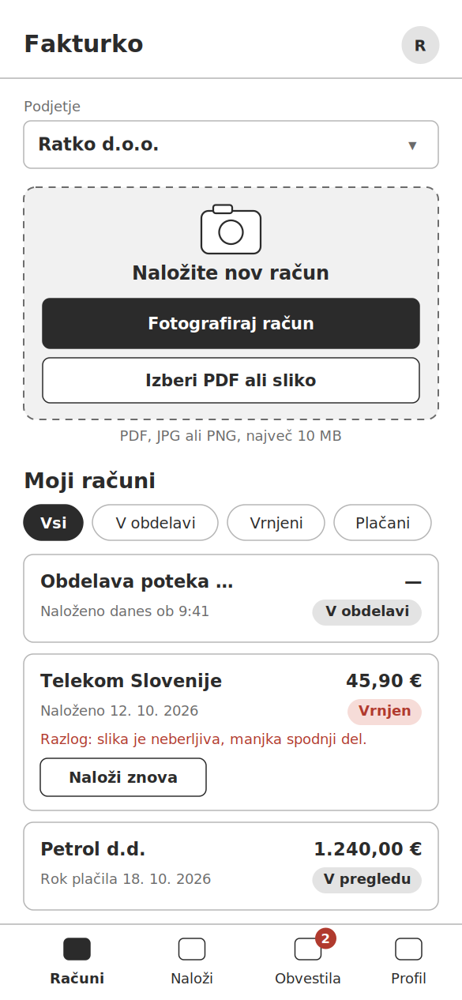
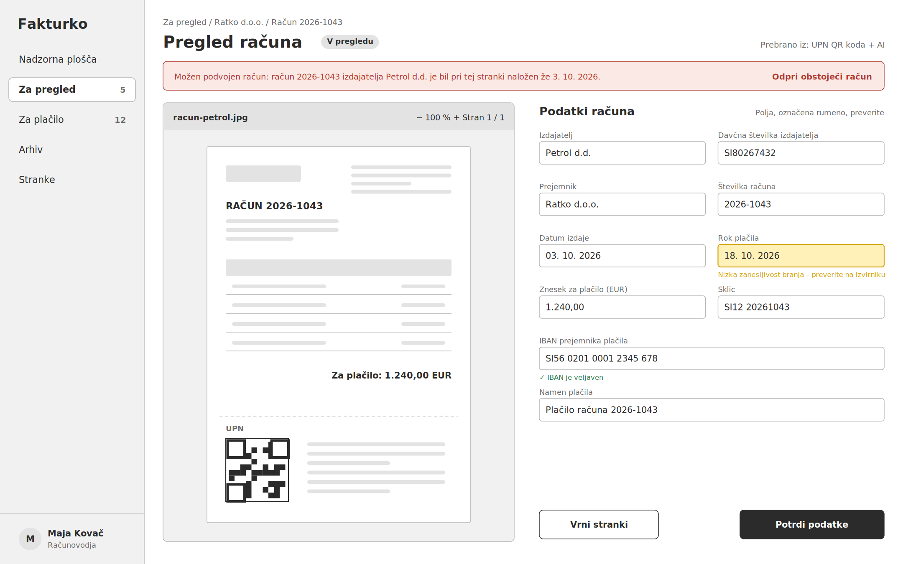
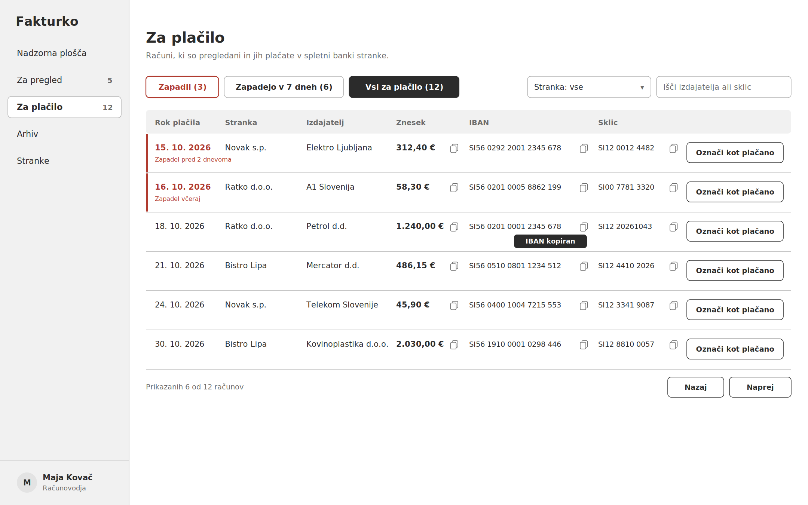
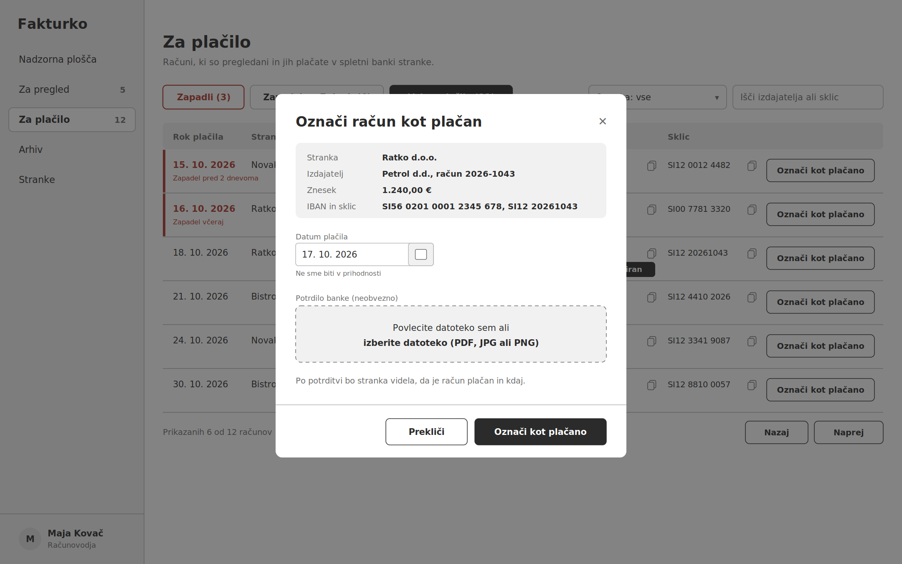
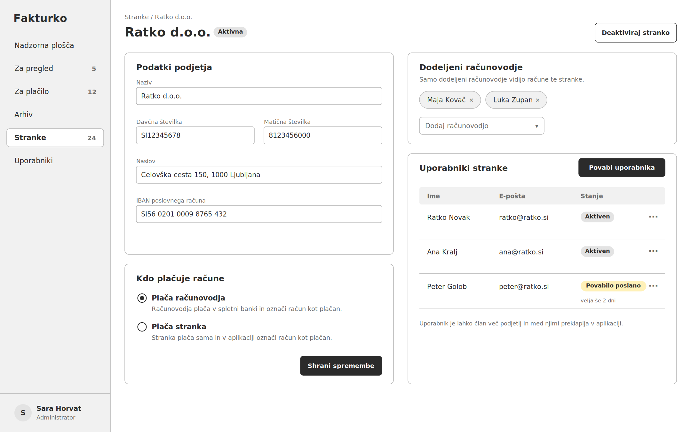

# Wireframes

Wireframi prikazujejo osnovni izgled ključnih zaslonov aplikacije Fakturko. So namenoma preprosti (sivi toni, brez končnega grafičnega oblikovanja) in prikazujejo razporeditev elementov, vsebino in glavna dejanja. Slike so v mapi `wireframes/`.

Rumena barva označuje podatke, ki jih mora uporabnik preveriti, rdeča pa opozorila in zapadle roke.

## 1. Stranka – nalaganje računa in seznam računov (telefon)

Zaslon, ki ga stranka najpogosteje uporablja na telefonu. Na vrhu izbere podjetje (če je članica več podjetij), nato račun fotografira ali izbere PDF oziroma sliko. Pod tem je seznam njenih računov s statusi in filtri. Vrnjen račun prikazuje razlog vrnitve in gumb »Naloži znova«. Spodnja navigacija vodi do računov, nalaganja, obvestil in profila.

**Povezane zgodbe:** US-01, US-05, US-10, US-15

## 2. Računovodja – pregled računa ob izvirniku

Osrednji zaslon za računovodjo. Na levi je izvirnik računa z možnostjo povečave, na desni podatki, ki jih je sistem prebral iz UPN QR kode ali z modelom AI. Polje z nizko zanesljivostjo branja (rok plačila) je obarvano rumeno, pri IBAN-u je prikazano, da je veljaven. Na vrhu je opozorilo na možen podvojen račun s povezavo do obstoječega računa. Računovodja podatke potrdi ali račun vrne stranki.

**Povezane zgodbe:** US-02, US-03, US-04, US-12

## 3. Računovodja – računi za plačilo

Seznam vseh pregledanih računov, ki čakajo na plačilo, razvrščen po roku plačila. Zavihki omogočajo hiter pregled zapadlih računov in računov, ki zapadejo v naslednjih 7 dneh. Zapadli računi so označeni rdeče. Ob znesku, IBAN-u in sklicu so gumbi za kopiranje, tako da računovodja podatke prenese v spletno banko brez prepisovanja (prikazano je obvestilo »IBAN kopiran«). Seznam je mogoče filtrirati po stranki, iskati in straničiti.

**Povezane zgodbe:** US-06, US-11

## 4. Označitev računa kot plačanega

Okno, ki se odpre po kliku na »Označi kot plačano«. Prikazuje povzetek računa, polje za datum plačila (privzeto današnji datum) in neobvezno nalaganje potrdila banke. Po potrditvi račun preide v status »Plačan« in stranka vidi datum plačila.

**Povezane zgodbe:** US-07, US-08

## 5. Administrator – nastavitve stranke

Stran posamezne stranke, ki jo ureja administrator. Vsebuje podatke podjetja, nastavitev načina plačila (plača računovodja ali plača stranka), seznam dodeljenih računovodij in uporabnike stranke. Novega uporabnika administrator doda z gumbom »Povabi uporabnika«; pri povabljenem uporabniku je prikazano, kako dolgo povabilo še velja.

**Povezane zgodbe:** US-09, US-14
